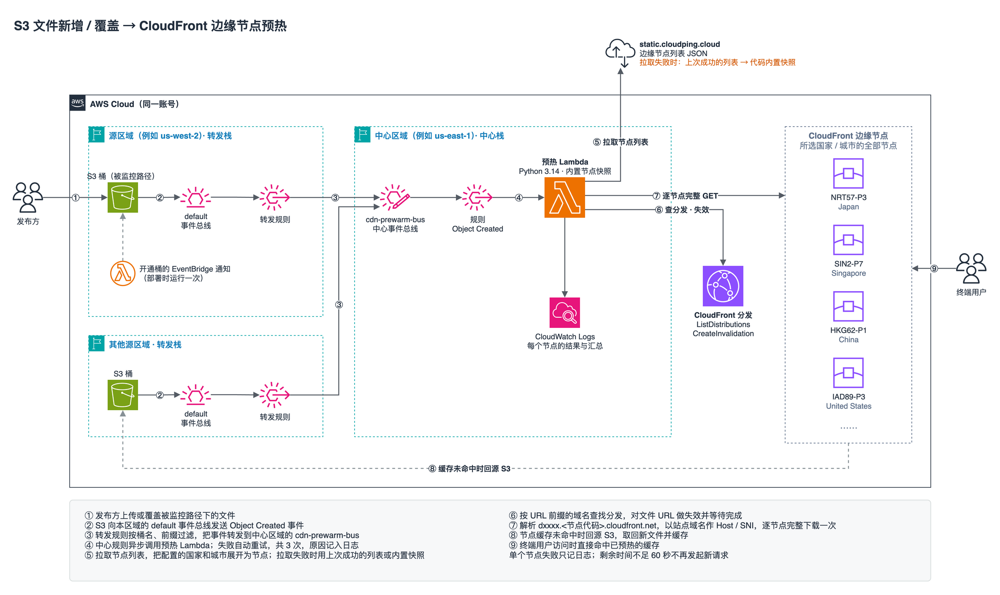

# CloudFront 边缘节点预热

S3 指定路径下有对象新增或覆盖时，Lambda 到指定国家或城市的每个 CloudFront 边缘节点各完整下载一次该对象，让这些节点提前缓存最新版本。



架构图源文件是 `architecture.drawio`，可以用 draw.io 打开编辑。`architecture.png` 里也嵌入了图的源数据，同样可以直接用 draw.io 打开。

```
各区域 S3 桶 ──(Object Created)──> 该区域 default 事件总线
                                      │ 转发规则（按桶名、可选按前缀过滤）
                                      ▼
                         中心区域 cdn-prewarm-bus ──> 预热 Lambda
                                                        ├─ 1. CloudFront 失效该 URL，等待完成
                                                        └─ 2. 逐节点 GET <域名>/<路径>
```

定向到指定节点的方法：解析 `<分发ID前缀>.<节点代码>.cloudfront.net`（例如 `d111111abcdef8.NRT57-P3.cloudfront.net`）得到该节点 IP，再以站点域名作为 Host/SNI 连接该 IP。响应头 `x-amz-cf-pop` 用来确认确实由目标节点处理。

## 文件

| 文件 | 说明 |
|---|---|
| `dist/cdn-prewarm-central.yaml` | 中心栈：事件总线、预热 Lambda、日志组。只部署一次。 |
| `dist/cdn-prewarm-forwarder.yaml` | 转发栈：部署在每个有被监控桶的区域，包括中心区域本身。 |
| `src/prewarm.py`、`src/enable_s3_eventbridge.py` | Lambda 源码，已内联到上面的模板里。 |
| `templates/`、`build.py` | 模板源文件。改了源码后运行 `python3 build.py` 重新生成 `dist/`。 |
| `refresh_edge_snapshot.py` | 更新 Lambda 代码里内置的节点快照，见"节点列表"一节。 |
| `architecture.drawio`、`architecture.png` | 架构图。 |
| `deployer-policy.json` | 部署、更新、删除两个栈所需的 IAM 权限，见"部署所需权限"一节。 |

## 部署

前提：桶、CloudFront 分发和中心栈在同一个 AWS 账号。Lambda 要在这个账号里按域名查找分发。

**1. 部署中心栈**（选一个区域作为中心，例如 us-east-1）

```bash
aws cloudformation deploy --region us-east-1 --stack-name cdn-prewarm \
  --template-file dist/cdn-prewarm-central.yaml --capabilities CAPABILITY_IAM \
  --parameter-overrides \
    "S3Paths=bucket-a/static/;bucket-b/img/" \
    "CdnUrlPrefixes=https://www.example.com/static/;https://img.example.com/" \
    "EdgeCountriesOrCities=Tokyo;Germany;United States" \
    "FilePatterns=*"
```

记下输出 `EventBusArn`。

**2. 在每个有桶的区域部署转发栈**

```bash
aws cloudformation deploy --region us-west-2 --stack-name cdn-prewarm-forwarder \
  --template-file dist/cdn-prewarm-forwarder.yaml --capabilities CAPABILITY_IAM \
  --parameter-overrides \
    "CentralEventBusArn=arn:aws:events:us-east-1:111122223333:event-bus/cdn-prewarm-bus" \
    "BucketNames=bucket-a" \
    "KeyPrefixes=static/;img/"
```

用控制台部署也可以：CloudFormation → 创建堆栈 → 上传模板文件，然后按页面填写参数。

### 部署所需权限

`deployer-policy.json` 是部署、更新、删除这两个栈所需的权限，可以直接挂给部署用的 IAM 用户或角色。我用一个只挂了这份策略的角色，实际跑过两个栈的创建、更新和删除。

为了好读，CloudFormation、Lambda、EventBridge、CloudWatch Logs 都合并成了 `cloudformation:*`、`lambda:*`、`events:*`、`logs:*`，但资源仍限定在 `cdn-prewarm` 开头的栈、函数、事件总线、规则和日志组。少数只能对 `*` 授权的查询操作（如 `cloudformation:ValidateTemplate`、`logs:DescribeLogGroups`）单独列在一条里。

IAM 没有合并成 `iam:*`，而是逐条列出。原因是 `iam:*` 会去掉 `iam:PassRole` 只能交给 Lambda 和 EventBridge 的限制，还会允许给角色挂任意托管策略（例如 `AdministratorAccess`），安全评审通常不会通过。

使用前提：

- 栈名必须以 `cdn-prewarm` 开头（例如 `cdn-prewarm`、`cdn-prewarm-forwarder`），中心栈的 `EventBusName` 也要以 `cdn-prewarm` 开头（默认 `cdn-prewarm-bus`）。策略里的资源都是按这个前缀限定的。要换前缀，把策略里所有 `cdn-prewarm` 一起替换。
- 部署时要加 `--capabilities CAPABILITY_IAM`，在控制台则勾选"我确认 AWS CloudFormation 可能创建 IAM 资源"。
- 策略里的 `iam:PassRole` 限定只能把这些角色交给 Lambda 和 EventBridge 使用。

用控制台上传模板时，控制台会先把模板存到 `cf-templates-*` 桶，还需要加下面这条。这一条没有包含在上面的实测里：

```json
{
  "Effect": "Allow",
  "Action": ["s3:CreateBucket", "s3:PutObject", "s3:GetObject"],
  "Resource": ["arn:aws:s3:::cf-templates-*", "arn:aws:s3:::cf-templates-*/*"]
}
```

如果组织用 SCP 要求创建角色时必须带权限边界（permissions boundary），需要在模板的三个 `AWS::IAM::Role` 上加 `PermissionsBoundary` 属性。

栈创建的三个角色各自的权限：

| 栈 | 角色 | 使用者 | 权限 |
|---|---|---|---|
| 中心栈 | `PrewarmRole` | 预热 Lambda | 写自己的日志组；`cloudfront:ListDistributions`（只能写 `*`）；本账号所有分发上的 `cloudfront:CreateInvalidation`、`cloudfront:GetInvalidation` |
| 转发栈 | `ForwardRole` | 转发规则 | `events:PutEvents`，只限中心事件总线 |
| 转发栈 | `EnableEventBridgeRole` | 开通通知的 Lambda | 写自己的日志组；`BucketNames` 里每个桶的 `s3:GetBucketLocation`、`s3:GetBucketNotification`、`s3:PutBucketNotification` |

## 参数

### 中心栈（对应 Lambda 环境变量）

| 参数 | 环境变量 | 说明 |
|---|---|---|
| S3Paths | `S3_PATHS` | 监控的 S3 路径，`;` 分隔。格式 `桶/前缀/`；只写 `桶` 表示整个桶。前缀按目录处理，`static` 等同于 `static/`。 |
| CdnUrlPrefixes | `CDN_URL_PREFIXES` | 每个 S3 路径对应一个 URL 前缀，按位置一一对应。域名填分发的备用域名（如 `www.example.com`）或 `dxxxx.cloudfront.net`。 |
| EdgeCountriesOrCities | `EDGE_COUNTRIES_OR_CITIES` | 要预热的国家和/或城市，`;` 分隔，可以混用，例如 `Tokyo;Germany;United States`。默认值也是这个。规则见下方"国家和城市的写法"。 |
| FilePatterns | `FILE_PATTERNS` | 只预热文件名匹配这些模式的文件，`;` 分隔，例如 `*.mp4;*.m3u8;*.ts`。默认 `*`，即所有文件。按文件名（key 最后一个 `/` 之后的部分）匹配，不区分大小写，`*` 匹配任意字符，`?` 匹配一个字符。对所有 S3 路径生效。不匹配的文件跳过，日志里记一条 `file name does not match FILE_PATTERNS`。 |
| InvalidateBeforePrewarm | `INVALIDATE_BEFORE_PREWARM` | 默认 `true`，预热前先失效该 URL 并等待完成。覆盖上传时必须开启，否则节点会继续返回旧缓存。 |
| EdgeLocationsUrl | `EDGE_LOCATIONS_URL` | 节点列表 JSON，Lambda 运行时拉取，缓存 1 小时。默认 `https://static.cloudping.cloud/cdn/cloudfront-edge-locations.json`。拉取失败时改用代码内置的快照，见"节点列表"一节。 |

只需要配置路径，不需要列出具体文件。路径下（包括子目录）任何文件新增或覆盖，都会自动预热这个文件。部署之前就已经存在的文件不会被预热。

预热 URL = URL 前缀 + 文件在 S3 路径之后的部分，会做 URL 编码。例如：

| S3 路径 | URL 前缀 | 上传的文件 | 预热 URL |
|---|---|---|---|
| `bucket-a/static/` | `https://www.example.com/static/` | `s3://bucket-a/static/js/app.js` | `https://www.example.com/static/js/app.js` |
| `bucket-b/img/` | `https://img.example.com/` | `s3://bucket-b/img/logo.png` | `https://img.example.com/logo.png` |

同一个文件匹配多条路径时，每条都会预热。

分发不用单独配置。Lambda 用 URL 前缀里的域名调 CloudFront API 查找对应的分发：先找完全相同的备用域名，再找通配域名（`*.example.com` 匹配 `cdn.example.com`，不匹配 `a.b.example.com`），也可以直接写 `dxxxx.cloudfront.net`。查询结果缓存 1 小时，找不到时会立即重查一次。仍然找不到时，本次调用失败并重试，日志里会写明是哪个域名。

#### 国家和城市的写法

名称取自节点列表的 `country` 和 `city` 字段，也可以在 `src/prewarm.py` 的 `EDGE_SNAPSHOT` 里查到。

- 写国家，预热这个国家的全部节点，例如 `Japan`、`United States`。香港和台北的节点在 `China` 下。
- 写城市，只预热这个城市的节点，例如 `Tokyo`、`Hong Kong`、`Frankfurt`。
- 国家和城市可以混用。重叠的节点只预热一次，例如 `Japan;Tokyo` 等同于 `Japan`。
- 不区分大小写，可以不写重音、空格和标点：`montreal` 能匹配 `Montréal, QC`，`Washington DC` 能匹配 `Washington D. C.`。
- 城市名后的州或地区代码可以省略：`Los Angeles` 能匹配 `Los Angeles, CA`，`Taipei` 能匹配 `Taipei, TW`。`Dallas/Fort Worth, TX` 写 `Dallas` 或 `Fort Worth` 都可以。
- 匹配不到节点的名称会记一条警告，其余名称照常预热。

每次预热的 `prewarm_start` 日志里有 `nodes_per_name` 字段，列出每个名称匹配到几个节点，例如 `{"Japan": 7, "Hong Kong": 5}`，可以用来检查名称有没有写对。

### 转发栈

| 参数 | 说明 |
|---|---|
| CentralEventBusArn | 中心栈输出的 `EventBusArn`。 |
| BucketNames | 本区域被监控的桶，`;` 分隔，不能有空格，例如 `bucket-a;bucket-b`。 |
| KeyPrefixes | 可选，只转发这些前缀下的对象，`;` 分隔，例如 `static/;img/`。建议填写，可以挡掉访问日志等无关写入。 |

所有列表参数（中心栈和转发栈）都用 `;` 分隔。
| EnableBucketEventBridge | 默认 `true`，为桶打开 "Send notifications to Amazon EventBridge"，保留桶上已有的其他通知配置。删除栈时不会关闭这个开关。 |

## 节点列表

Lambda 按下面的顺序取节点列表：

1. 1 小时内从 `EDGE_LOCATIONS_URL` 拉到的列表。
2. 重新从 `EDGE_LOCATIONS_URL` 拉取。
3. 拉取失败（网络错误、非 200、不是 JSON、列表里没有节点）时，用本次 Lambda 运行环境里上一次拉取成功的列表。
4. 运行环境里还没有拉取成功过，就用代码内置的快照。快照只保留"国家 → 城市 → 节点代码"，生成日期写在 `EDGE_SNAPSHOT_DATE`。

每次预热的 `prewarm_start` 日志里有 `edge_list` 字段，记录本次用的是哪份列表：`url`、`url, fetched <时间>` 或 `snapshot <日期>`。

更新快照：

```bash
python3 refresh_edge_snapshot.py   # 重写 src/prewarm.py 里的 EDGE SNAPSHOT 段
python3 build.py                   # 重新生成 dist/ 模板
```

然后用新模板更新中心栈。

## 查看结果

日志组 `/aws/lambda/<中心栈名>-prewarm`。每个节点一完成就写一条 `prewarm_result`，所有节点结束后每个文件写一条 `prewarm_summary`。CloudWatch Logs Insights 查询没成功的节点：

```
fields @timestamp, url, node, outcome, error
| filter type = "prewarm_result" and ok = 0
| sort @timestamp desc
```

`prewarm_result` 的 `outcome` 字段：

| outcome | 含义 |
|---|---|
| `ok` | 返回 2xx，且 `x-amz-cf-pop` 等于目标节点 |
| `failed` | 这个节点出错：解析不到 IP、所有 IP 都连不上、超时、返回非 2xx、由别的节点响应，或其他任何异常 |
| `not_started` | Lambda 剩余时间不足 60 秒，没有发起请求 |
| `aborted` | 下载到一半时 Lambda 剩余时间不足 15 秒，主动中止 |

`etag_match` 表示节点返回的 ETag 与 S3 事件中的一致。`prewarm_summary` 里有各类结果的数量，以及 `failed_nodes`、`unfinished_nodes`（`not_started` 和 `aborted` 的节点）、`skipped_urls`。

## 用 curl 验证

上传文件后，用 curl 直接请求某个节点，看它是否已经缓存了新文件：

```bash
DOMAIN=www.example.com              # CdnUrlPrefixes 里的域名
FILE_PATH='/static/js/应用.js'       # 要验证的文件路径，可以含中文或空格，下面会自动做 URL 编码
NODE=NRT12-P5                       # 节点代码，从这次预热的 prewarm_result 日志里取，见下方说明

# 分发域名 dxxxx.cloudfront.net 的前缀。域名走通配备用域名（*.example.com）时，这里查不到，请到 CloudFront 控制台复制
DIST=$(aws cloudfront list-distributions --output text \
  --query "DistributionList.Items[?Aliases.Items && contains(Aliases.Items, '$DOMAIN')].DomainName | [0]" | cut -d. -f1)

URL_PATH=$(python3 -c 'import urllib.parse,sys; print(urllib.parse.quote(sys.argv[1]))' "$FILE_PATH")

curl -sI -m 15 --retry 3 --retry-all-errors -H 'Accept-Encoding: gzip, deflate, br' \
  --connect-to "$DOMAIN:443:$DIST.$NODE.cloudfront.net:443" \
  "https://$DOMAIN$URL_PATH" | grep -iE '^(HTTP/|x-cache:|x-amz-cf-pop:|etag:|age:)'
```

`--connect-to` 让 curl 把连接发到节点域名 `dxxxx.<节点代码>.cloudfront.net`，网址、Host 和 SNI 仍然是站点域名，和用户真实访问时一样。curl 会自己解析节点域名，一个 IP 连不上会自动换下一个；连接中途被重置时，`--retry 3 --retry-all-errors` 会再试最多 3 次（需要 curl 7.71 及以上，macOS 自带的版本满足）。

不要把 `dxxxx.<节点代码>.cloudfront.net` 直接当网址访问：CloudFront 只认分发的备用域名和 `dxxxx.cloudfront.net`，HTTPS 会握手失败，HTTP 会返回 403。这个域名只用来找到节点的 IP。

预热成功时的输出类似：

```
HTTP/2 200
etag: "b1bf01b86ec379951e7dedcd78e199c9"
x-cache: Hit from cloudfront
x-amz-cf-pop: NRT12-P5
age: 55
```

判断方法：

- `x-amz-cf-pop` 等于 `NODE`，说明请求确实落在这个节点上。
- `x-cache` 为 `Hit from cloudfront`，说明这个节点已经有缓存。
- `etag` 等于 S3 上这个文件的 ETag，说明缓存的是新版本。S3 上的 ETag 可以用 `aws s3api head-object --bucket <桶> --key <key> --query ETag` 查看。

几点说明：

- **节点代码要用这次预热过的。** 节点会上线下线，网页或旧列表里的节点可能已经不在当前列表中，Lambda 不会预热它，有的甚至连不上。在中心栈的日志组里用 Logs Insights 查这个文件预热成功的节点：

  ```
  fields node, x_cache, etag_match
  | filter type = "prewarm_result" and outcome = "ok" and url like "app.js"
  | sort node
  ```

- **没有任何输出**：说明从你的网络连不上这个节点，和是否预热无关。可以去掉 `-s` 看 curl 的报错，或换一个节点、换一个网络再试。
- 用 `-I` 只取响应头，不会下载整个文件。
- 请求一定要带 `Accept-Encoding: gzip, deflate, br`。不带这个头请求的是另一份缓存，会显示 `Miss`。

## 容错

- 单个节点的任何错误只记为这个节点 `failed`，其他节点照常。失败的节点不重试。
- 一个文件匹配多条路径时，某条路径的域名找不到分发，只跳过这一条，记一条 ERROR 日志，写入 `skipped_urls`，其他路径照常。
- Lambda 最长运行 15 分钟。剩余时间不足 60 秒时不再发起新请求，下载中的请求在剩余 15 秒时中止，保证所有节点的结果和汇总都能写进日志。因时间不够没做完的节点不会触发重试，因为重试还会遇到同样的时间限制。
- 节点列表拉不到时，依次改用上次拉取成功的列表和内置快照，见"节点列表"一节。

以下情况本次调用失败，Lambda 自动再重试 2 次（共 3 次）：

- 发起的请求一个都没成功，并且至少有一个是 `failed`。
- 匹配的路径都找不到分发。
- 配置的国家和城市全都匹配不到节点。
- 配置错误，例如 `S3Paths` 和 `CdnUrlPrefixes` 条数不一致。
- 失效请求报错，或者 5 分钟内没有完成。

3 次都失败的事件直接丢弃，不保存，每次失败的原因都记在日志组里。方案没有用死信队列，因为预热漏掉一次的影响很小：用户第一次访问时节点会自己回源，只是这一次慢一点。需要补预热时，重新上传该文件即可。查 Lambda 报错的日志：

```
fields @timestamp, errorType, errorMessage, message
| filter level = "ERROR"
| sort @timestamp desc
```

调用失败时，错误原因在 `errorMessage` 字段；跳过某条路径时，原因在 `message` 字段。

EventBridge 跨区域转发失败时会自动重试，最长 24 小时，之后同样丢弃。

## 注意事项

- **分发必须允许缓存。** 如果缓存策略是 `Managed-CachingDisabled` 或 TTL 为 0，预热不会有效果。
- **流量与费用。** 每上传一个文件，Lambda 从 CloudFront 下载的流量约为 `文件大小 × 节点数`，例如 100 MB 文件预热 50 个节点就是 5 GB，按 CloudFront 数据传输费计费。回源 S3 的流量会少一些，因为多个节点共用区域边缘缓存。CloudFront 失效每月前 1000 条路径免费，之后每条 $0.005。
- **压缩版本。** 预热请求带 `Accept-Encoding: gzip, deflate, br`，与浏览器一致。不带该头的客户端（例如默认的 curl）命中的是另一份缓存。
- **节点列表。** 列表来自第三方站点 static.cloudping.cloud，有些节点可能已经下线。下线节点会记为失败，不影响其他节点。一个节点通常有多个 IP，某个 IP 连不上时会换下一个。
- **不要监控日志写入的路径。** 如果桶的访问日志或 CloudFront 日志写在被监控的路径下，每次预热产生的日志又会触发预热，形成循环。
- **改配置。** 直接在 Lambda 控制台改环境变量可以立即生效，但下次更新栈时会被模板参数覆盖。长期修改请更新栈参数。
- **删除事件。** 删除事件不触发任何操作。
