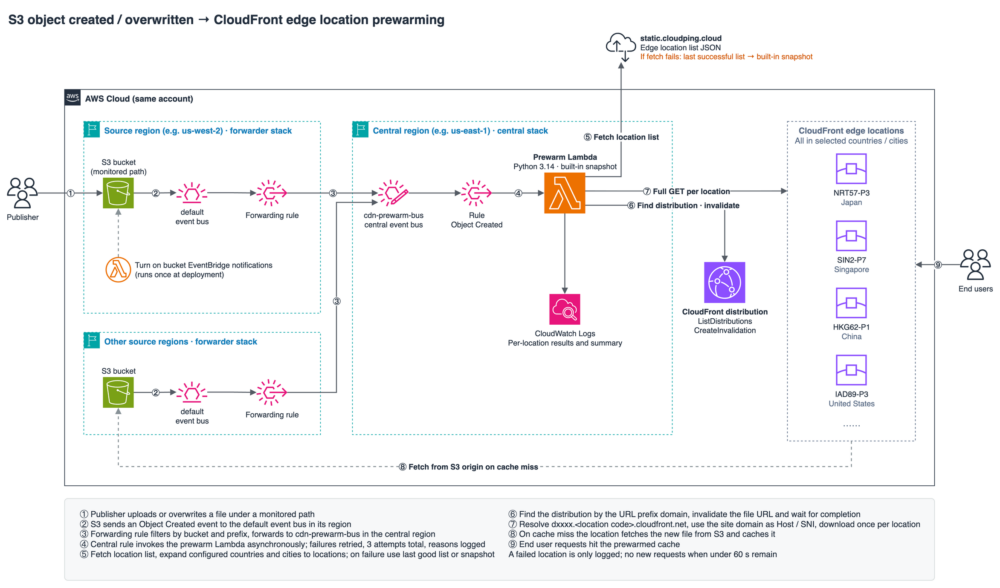

# CloudFront Edge Location Prewarming

When an object is created or overwritten under a configured S3 path, a Lambda function downloads it once from every CloudFront edge location in the configured countries or cities, so those locations cache the new version before users ask for it.



```
S3 bucket (any region) ──> default event bus ──forwarding rule──> cdn-prewarm-bus (central region) ──> prewarm Lambda
                                                                                      1. invalidate the URL
                                                                                      2. GET it from each edge location
```

## Deployment

The buckets, the CloudFront distributions, and the central stack must be in the same AWS account.

**1. Deploy the central stack** once, in any region:

```bash
aws cloudformation deploy --region us-east-1 --stack-name cdn-prewarm \
  --template-file dist/cdn-prewarm-central.yaml --capabilities CAPABILITY_IAM \
  --parameter-overrides \
    "S3Paths=bucket-a/static/;bucket-b/img/" \
    "CdnUrlPrefixes=https://www.example.com/static/;https://img.example.com/" \
    "EdgeCountriesOrCities=Tokyo;Germany;United States" \
    "FilePatterns=*"
```

**2. Deploy the forwarder stack** in every region that has a bucket, using the central stack's `EventBusArn` output:

```bash
aws cloudformation deploy --region us-west-2 --stack-name cdn-prewarm-forwarder \
  --template-file dist/cdn-prewarm-forwarder.yaml --capabilities CAPABILITY_IAM \
  --parameter-overrides \
    "CentralEventBusArn=arn:aws:events:us-east-1:111122223333:event-bus/cdn-prewarm-bus" \
    "BucketNames=bucket-a" \
    "KeyPrefixes=static/;img/"
```

`deployer-policy.json` has the IAM permissions needed to deploy. It only covers resources named `cdn-prewarm*`, so keep that prefix in stack names. Deploying from the console also needs `s3:CreateBucket`, `s3:PutObject`, and `s3:GetObject` on `cf-templates-*` buckets.

## Parameters

List parameters are separated by `;`.

**Central stack**

| Parameter | Description |
|---|---|
| S3Paths | Paths to monitor, as `bucket/prefix/` or just `bucket`. |
| CdnUrlPrefixes | One URL prefix per S3 path, in the same order. |
| EdgeCountriesOrCities | Countries and/or cities, for example `Tokyo;Germany;United States` (the default). |
| FilePatterns | File name patterns to prewarm, for example `*.mp4;*.m3u8`. Default `*`. |
| InvalidateBeforePrewarm | Default `true`. Keep it on if files get overwritten. |
| EdgeLocationsUrl | Edge location list. Default `https://static.cloudping.cloud/cdn/cloudfront-edge-locations.json`, with a built-in snapshot as fallback. |

The prewarm URL is the URL prefix plus the rest of the key: with `bucket-a/static/` → `https://www.example.com/static/`, uploading `static/js/app.js` prewarms `https://www.example.com/static/js/app.js`. The Lambda finds the distribution by the URL's domain.

Country and city names come from the edge location list. Matching ignores case, accents, and punctuation, and the state code can be omitted (`Los Angeles` matches `Los Angeles, CA`). Hong Kong and Taipei are under `China`.

**Forwarder stack**

| Parameter | Description |
|---|---|
| CentralEventBusArn | `EventBusArn` output of the central stack. |
| BucketNames | Buckets in this region, for example `bucket-a;bucket-b`. |
| KeyPrefixes | Optional. Only forward objects under these prefixes. |
| EnableBucketEventBridge | Default `true`: turns on EventBridge notifications for the buckets. |

## Viewing results

Logs are in `/aws/lambda/<central stack name>-prewarm`, one `prewarm_result` per edge location and one `prewarm_summary` per file. Locations that did not succeed:

```
fields @timestamp, url, node, outcome, error
| filter type = "prewarm_result" and ok = 0
| sort @timestamp desc
```

`outcome` is `ok`, `failed`, or, when the Lambda ran out of time, `not_started` / `aborted`.

## Verifying with curl

```bash
DOMAIN=www.example.com              # domain in CdnUrlPrefixes
FILE_PATH='/static/js/my_app.js'
NODE=NRT12-P5                       # location code from this file's prewarm_result logs
DIST=d111111abcdef8                 # prefix of the distribution domain dxxxx.cloudfront.net

URL_PATH=$(jq -rn --arg p "$FILE_PATH" '$p | split("/") | map(@uri) | join("/")')

curl -sI -m 15 --retry 3 --retry-all-errors -H 'Accept-Encoding: gzip, deflate, br' \
  --connect-to "$DOMAIN:443:$DIST.$NODE.cloudfront.net:443" \
  "https://$DOMAIN$URL_PATH" | grep -iE '^(HTTP/|x-cache:|x-amz-cf-pop:|etag:|age:)'
```

A successful prewarm shows `x-amz-cf-pop` equal to `NODE`, `x-cache: Hit from cloudfront` (or `RefreshHit`, meaning the cached copy expired and was revalidated with the origin), and the same `etag` as in S3. No output means your network can't reach that location.

## Caveats

- **Caching must be enabled** on the distribution, otherwise prewarming does nothing.
- **Cost.** Each upload downloads about `file size × number of locations` from CloudFront (100 MB × 50 locations = 5 GB).
- **Don't monitor paths that logs are written to**, or each prewarm triggers another.
- **Failures.** A failed location is not retried. If no location succeeds, Lambda retries the whole event twice, then drops it. To prewarm again, upload the file again.
- **Code changes.** After editing `src/`, run `python3 build.py` to regenerate `dist/`. `python3 refresh_edge_snapshot.py` updates the built-in edge location snapshot.
